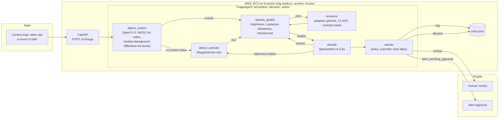

# Architecture

**The loop is the point.** OpenCV 5 measurements decide which tool is called next:

| Visual evidence | Next action |
| --- | --- |
| No motion found | Retry motion detection with a lower threshold |
| Still no motion | Call MegaDetector (slower, finds animals that stood still) |
| Frame dark or blurry | Enhance, then re-measure; if still poor, move to the next sharpest frame |
| Classifier unsure | Re-classify the enhanced crop, then try another frame (up to 3 attempts) |
| Motion found but classifier says "blank" | Ask MegaDetector; re-crop around its box, or discard if it agrees |
| Top answer is a look-alike of a watch-listed species | Send to human review |
| Watch-listed species | Raise an alert that waits for a person to approve it |

Every step is recorded as `{tool, inputs, observation, decision}` in the trace returned by the API.
